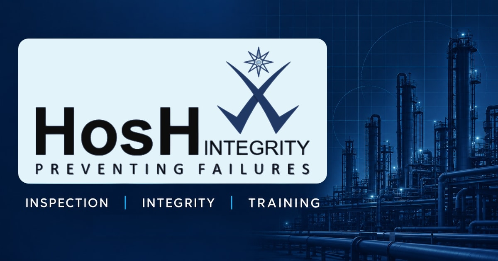

# 🛡️ HosH Integrity

**Preventing Failures**

Industrial inspection · Technical assurance · Professional training

[🌐 Review website](https://hos-h.vercel.app) · [👤 Client guide](docs/README-client.md) · [🧑‍💻 Developer guide](docs/README-developer.md) · [🚀 Launch tracker](docs/launch-checklist.md)

## 👋 Welcome

The HosH Integrity website presents the company’s inspection services, industries, training, credentials and enquiry options. It uses the client approved design and supplied company material, with layouts for desktop, tablet and mobile.

**Current stage:** development and review. The intended public domain is **hoshintegrity.com**. Its client hosting connection, DNS and Search Console setup are still pending. The review address may require Vercel access.

## 🧭 Choose your guide

| I want to… | Start here |
| --- | --- |
| 👤 Understand the website, ownership and what happens next | [Client README](docs/README-client.md) |
| 🧑‍💻 Run the code, make changes and verify a release | [Developer README](docs/README-developer.md) |
| 🚦 Follow every launch task and its evidence | [Master launch checklist](docs/launch-checklist.md) |
| 📋 Check which business facts are confirmed | [Content evidence](docs/content-evidence.md) |
| 🖼️ Understand the source of the photographs and sharing card | [Image provenance](docs/image-provenance.md) |

## ✨ Website highlights

| | What is included |
| --- | --- |
| 🏭 **Company capabilities** | Service, industry, training and credentials pages based on supplied material |
| 📱 **Responsive experience** | Desktop, tablet and mobile layouts with accessible navigation |
| ✉️ **Enquiries** | Contact form and Gmail compose links for the confirmed business inbox |
| 🍪 **Privacy choices** | First visit banner and footer settings, with optional storage off by default |
| 🔎 **Search preparation** | Page titles, descriptions, canonical URLs, structured data, robots and sitemap |
| 🖼️ **Social sharing** | A 1200 × 630 logo and tagline card, without a printed website address |
| 🛡️ **Release checks** | CI verification, dependency auditing and security response headers |

## 🚦 Honest release status

🟢 **Done** means verified in the stated environment. 🟡 **In progress** means partly prepared. 🔴 **To do** means not completed.

| Status | Area | What it means |
| --- | --- | --- |
| 🟢 | Website development | Pages, privacy controls and technical SEO are implemented |
| 🟢 | Previous application verification | Build, types, route checks and responsive browser checks passed; see the tracker for release evidence |
| 🟢 | Local checks for this revision | Build, types, lint, route checks, sharing metadata and documentation links pass; connected results are recorded by GitHub and Vercel |
| 🟡 | SonarQube | Latest recorded result is “Quality Gate not computed”, not a passed gate |
| 🟡 | Enquiry delivery | Inbox is configured; provider activation and a real delivery test remain |
| 🔴 | Client production launch | Client repository, suitable hosting, DNS, HTTPS and GSC verification remain |

The workflow badge shows the current GitHub check. It does not certify every provider setting, legal requirement or final domain behaviour. SEO cannot guarantee first place on Google.

## 🤝 Ownership and handoff

Development currently lives in **[Raazia-Imran/HosH](https://github.com/Raazia-Imran/HosH)**. At the agreed release stage, a separate repository in **hoshintegrityinfo-gif** will receive the agreed full Git history. The client repository then becomes the source for production and future maintenance. The portfolio copy remains separate under the client agreement and does not automatically synchronise.

The website represents **HosH Integrity**, with the confirmed contact **hoshintegrityinfo@gmail.com** and location **Karachi, Pakistan**. Repository maintenance is under the Raazia-Imran GitHub account. Public repository visibility does not grant a general licence to reuse the client branding, content or photographs.

> [!IMPORTANT]
> Preserve the approved design, the complete `.lovable/` folder and published Git history. Keep account passwords, tokens and recovery codes out of the repository.

## 🚀 Continue the project

Start with [the next actions in the launch tracker](docs/launch-checklist.md#next-actions-for-the-current-work-session). The client guide explains those actions in everyday language; the developer guide contains commands and release procedures.
